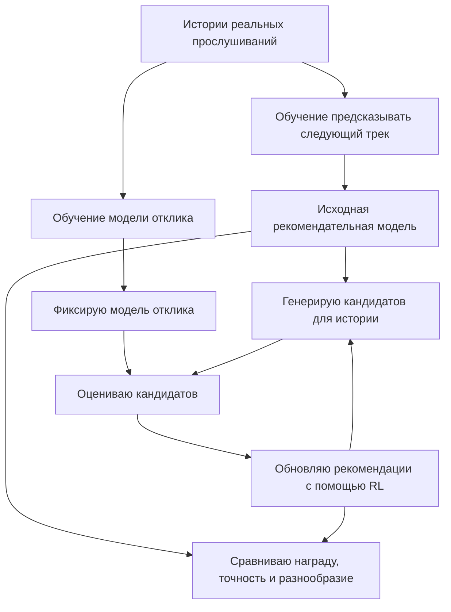
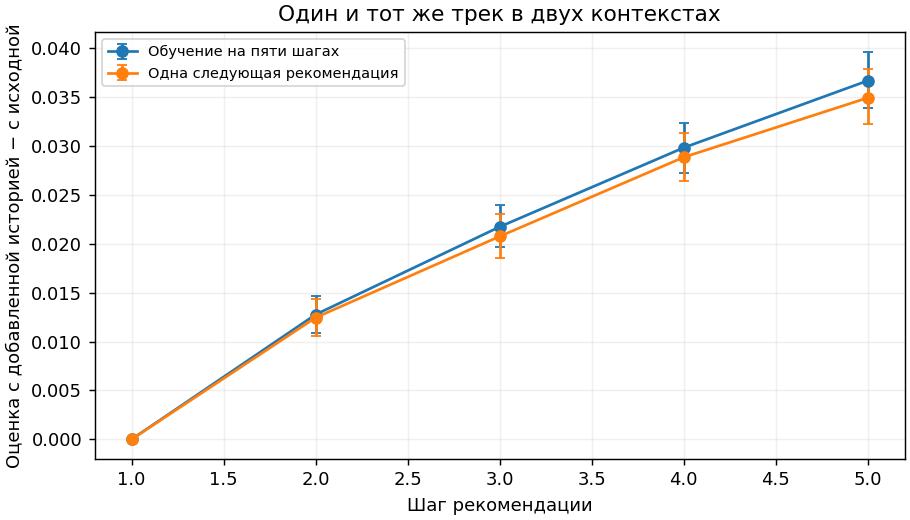
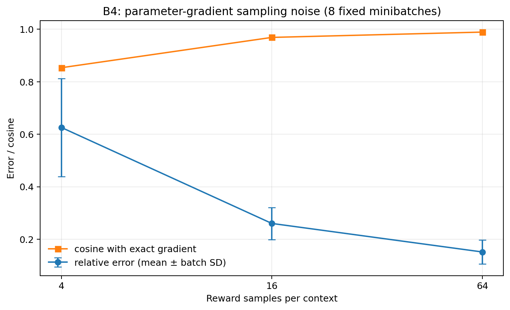

# Дообучение последовательной рекомендательной модели с помощью обучения с подкреплением

**Навигация:** [о чем исследование](#о-чем-это-исследование) · [данные и модели](#данные-архитектура-и-защита-от-утечек-из-будущего) · [как устроено RL](#как-устроено-обучение-с-подкреплением) · [ответы на вопросы](#вопрос-1-как-меняется-поведение-модели-после-rl-дообучения) · [итоги](#итоги-исследования-и-ограничения) · [запуск](#запуск-и-воспроизведение) · [литература](#литература)

* **Датасет:** Yambda-50M (Яндекс Музыка, 46,47 млн событий прослушивания, каталог из 20 000 треков)
* **Базовая архитектура:** трансформер GPT-2 со случайной инициализацией весов (8,35 млн параметров)
* **Методы:** групповое обучение весов GPT по награде (вариант GRPO) и точный градиент по всему каталогу; отдельно небольшая обучаемая голова поверх замороженной GPT, меняющая вероятности внутри top-500 кандидатов. Для головы сравниваются sampled LOO и точный градиент. Аналитическое реранжирование служит контролем без обучения.

---

## О чем это исследование

В современных рекомендательных системах популярна идея обучать трансформер по принципу языковой модели, подавать на вход историю прослушанных пользователем треков и учить сеть угадывать следующий трек. Проблема в том, что сам факт включения трека еще не означает, что рекомендация оказалась удачной, пользователь может переключить песню через несколько секунд.

Возникает вопрос: **можно ли взять обученную базовую модель и дообучить ее с помощью обучения с подкреплением, чтобы она рекомендовала треки, которые пользователи будут дослушивать до конца, слушать дольше по времени или лайкать?**

Я провел серию экспериментов на датасете **Yambda-50M** и проверил, как такое дообучение меняет поведение рекомендательной системы.

### Главный результат и ключевое сравнение

В финальной серии экспериментов базовая трансформерная модель (`Strong GPT`, 8,35 млн параметров) оставалась замороженной, а поверх нее обучалась небольшая нейросетевая голова (MLP 54→64→64→1). Голова перераспределяла вероятности внутри top-500 кандидатов базовой модели, максимизируя предсказанную долю дослушивания трека (с KL-штрафом $\beta=3$ за отклонение от исходного распределения GPT). В качестве модели награды (RM) использовался градиентный бустинг в трех вариантах: табличная модель на 26 423 событиях и модели с признаками сходства треков (affinity) на 21 290 (малая RM) и 100 000 событиях (большая RM).

Оценка проведена единым способом на **4 065 пользователях** (каталог из 20 000 треков; редкие треки вне каталога засчитываются как промахи). Сравнивались две офлайн-задачи, различие между которыми принципиально для интерпретации:
* **Следующий трек (Next-item NDCG@10 / HR@10):** угадывание непосредственно следующего рекомендательного прослушивания (одна цель на пользователя; 1 443 из 4 065 целей лежат вне каталога).
* **Суточные прослушивания (24h positive NDCG@10 / Recall@10):** совпадение рекомендаций с уникальными рекомендательными треками, которые пользователь прослушал хотя бы наполовину (`ratio ≥ 0,5`) в последующие 24 часа (рассчитано по **3 024 пользователям**, у которых в данных есть полный суточный интервал и непустое множество таких треков). Это совпадение с уже записанными в логах событиями, а не измерение живой реакции на новую выдачу.

| Метод | Next NDCG@10 | Next HR@10 | 24h positive NDCG@10 | 24h positive Recall@10 |
|---|---:|---:|---:|---:|
| Базовая модель (Strong GPT) | 0,014787 | 0,029274 | 0,037052 | 0,022037 |
| RL с табличной моделью награды (26k) | 0,014890 | 0,029848 | 0,038235 | 0,023056 |
| Точный градиент с табличной моделью награды (26k) | 0,014901 | 0,029766 | 0,038158 | 0,022971 |
| RL с малой моделью награды (21k) | 0,015074 | 0,030258 | 0,037858 | 0,022940 |
| RL с большой моделью награды (100k) | 0,015149 | 0,030586 | 0,038095 | 0,023173 |
| Точный градиент с большой моделью награды (100k) | 0,015244 | 0,030750 | 0,038235 | 0,023123 |
| RL без дополнительных признаков сходства в голове | 0,015183 | 0,030586 | 0,038048 | 0,023108 |
| Аналитическое реранжирование с большой моделью награды ($\beta=3$) | 0,015524 | 0,031734 | 0,037959 | 0,022854 |

Для обученных голов показано среднее по трём запускам; базовая GPT и аналитическое реранжирование детерминированы.


**Что удалось улучшить (суточные метрики на основной выборке):**
* **С табличной моделью награды (26 423 события):** суточный Recall@10 вырос с 0,02204 до 0,02306 (**+4,6%**, парный 95% CI прироста $[0,000101; 0,002099]$), а 24h NDCG@10 — с 0,03705 до 0,03824 (**+3,2%**, 95% CI $[0,000498; 0,001877]$). Оба интервала лежат выше нуля.
* **С большой моделью награды (100 000 событий):** прирост 24h NDCG@10 относительно базовой GPT составил **+0,001043** (обычный 95% CI $[0,000385; 0,001726]$; скорректированный 97,5% CI с поправкой Бонферрони на два заранее выбранных сравнения $[0,000287; 0,001799]$).

**Чего показать не удалось:**
* **Улучшение предсказания следующего трека:** разница по Next NDCG@10 статистически незначима (для табличной RM +0,000104, 95% CI $[-0,000549; 0,000706]$; для большой RM +0,000363, 95% CI $[-0,000226; 0,000960]$).
* **Преимущество большой модели награды над малой:** при увеличении выборки RM с 21 290 до 100 000 событий ошибка прогноза самой RM снизилась, но в рекомендациях разница 24h NDCG между большой и малой RM составила +0,000238 (95% CI $[-0,000014; 0,000502]$, 97,5% CI $[-0,000061; 0,000535]$).
* **Преимущество RL над точным градиентом и аналитическим реранжированием:** статистически подтверждённое преимущество обучения по выборке (`sampled LOO`) перед точным градиентом и аналитическим реранжированием не установлено.
* **Устойчивый перенос на более поздний период:** на отложенных по времени 710 контекстах (487 с непустым суточным множеством) интервалы разницы 24h NDCG включают ноль.
### Краткие ответы на вопросы исследования

| Вопрос исследования | Что получилось по результатам всех экспериментов |
|---|---|
| Как меняется поведение после RL? | Модель начинает чаще выбирать треки с высокой оценкой награды. В ранних опытах она смещалась к более коротким песням и к трекам, которых оценщик не видел при обучении. В финальном эксперименте доля знакомых треков в top-10 выросла с 63,96% до 64,98%, но сильного смещения к одному общему фавориту не было. |
| Улучшаются ли рекомендации? | На основной исторической выборке удалось улучшить предсказание рекомендательных треков, прослушанных хотя бы наполовину за 24 часа. Для следующего трека и более позднего периода уверенного улучшения нет: доверительные интервалы включают ноль. Это не доказывает и того, что модели одинаковы. |
| Можно ли приблизиться к долгосрочным целям? | Я попробовал учитывать сам рекомендуемый трек при прогнозе продолжения прослушивания и возврата пользователя, но лучше прогноз не стал. Суточный Recall по прослушанным трекам не измеряет удержание пользователя. |
| Что происходит при генерации пяти треков? | Если дописывать сгенерированные треки в историю, оценщик повышает прогноз дослушивания на 3,5–3,7 п.п. даже без действий пользователя. При пятишаговом обучении стало больше малоизученных треков, но выигрыша в точности я не обнаружил. |
| От чего зависит компромисс награды и точности? | От самой награды, силы KL-штрафа, набора доступных кандидатов и точности оценщика. Прямой градиент оказался сопоставим с RL по выборке; доказать преимущество сэмплирования не удалось. Даже когда RM стала точнее, это не гарантировало улучшения рекомендаций. |

Дальше я сначала описываю данные и базовые модели, затем объясняю, как проводилось RL-дообучение, и разбираю результаты по пяти вопросам. К первоначальным экспериментам добавлены проверки GPT, отдельные исследования модели награды и финальные сравнения. При чтении таблиц важно помнить, что использовались разные выборки и версии оценщика: напрямую сравнивать числа можно только при одинаковых условиях оценки.

---

## Данные, архитектура и защита от утечек из будущего

### Как устроен датасет и каталог треков

В работе используется открытый датасет прослушиваний **Yambda-50M** от Яндекс Музыки. Чтобы результаты были честными и воспроизводимыми, важно разделить общий размер сырых логов и те выборки, которые реально подаются в модели:

* **Общий объем сырого лога:** **46 467 212 событий прослушивания** от **9 238 пользователей** по **877 168 уникальным трекам**.
* В логах все прослушивания делятся на **органические** **24 003 657 событий** когда пользователь сам нашел и включил трек и **неорганические** **22 463 555 событий** прослушивания по рекомендациям сервиса. Кроме того, в отдельных таблицах записаны **881 456 лайков** и **312 972 отмены лайков**.
* Поскольку предсказывать почти 880 тысяч редких треков напрямую неэффективно, я отобрал **20 000 самых частых треков** строго по неорганическим событиям обучающего периода. Этот каталог покрывает **60,38%** целевых прослушиваний на валидации и **60,03%** на тесте. Всего в обучающем периоде получилось **11 129 476 валидных целевых событий**.
* Если в валидационном или тестовом периоде пользователь послушал редкий трек, не попавший в топ-20 000 каталога, то он засчитывается модели как промах.

### Архитектура базовой рекомендательной модели

В качестве рекомендательной модели используется архитектура **GPT-2 со случайной инициализацией весов**. Каждый трек представлен собственным токеном: названия песен, текстовый токенизатор и готовые языковые веса не используются.
* **Размер контекста:** на вход модели подается токен начала истории и **до 200 предшествующих событий** пользователя.
* **Параметры нейросети:** 4 трансформерных блока, размерность скрытого состояния 256, 4 головы механизма внимания, до 256 позиций контекста, dropout 0,1, связанные матрицы входных и выходных эмбеддингов. Общее число обучаемых параметров составляет **8 345 856**.


### Разбиение по времени

Последние 7 дней данных оставлены для теста, предыдущие 14 для валидации, более ранняя история для обучения. Каталог построен только по обучающему периоду. Модель отклика обучена на его ранней части; затем выделены 7 дней для ее проверки и еще 7 дней с историями для RL. Предсказываемый трек не входит в свою входную историю.

Для ранних сравнений с обновлением всей GPT использованы 1 024 пользователя, по одной цели на человека: половина для выбора настроек, половина для проверки. Эти выборки уже изучались в предыдущих итерациях, поэтому повторная оценка не является независимым подтверждением. Метрики усредняются сначала внутри пользователя, затем между пользователями с равным весом.

### Панели последующих экспериментов и смысл метрик

В следующих экспериментах я оставил тот же каталог из 20 000 треков и по-прежнему считал редкие треки вне каталога промахами. В задаче предсказания следующего трека целью служит **неорганическое прослушивание**, то есть трек, включенный через рекомендации сервиса. При этом в самой истории пользователя могут быть и органические прослушивания: я фильтровал целевое событие, а не выкидывал из контекста все остальное.

| Панель | Объем | Роль |
|---|---:|---|
| Раннее сравнение из исходного отчета | 1 024 пользователя, в том числе 512 для отбора | Историческая оценка обучения весов GPT |
| Общая панель проверки базовых моделей | 6 655 пользователей, одна цель на человека | Сравнение strong, dense и простых методов одним evaluator |
| Промежуточные серии голов | 4 134 train / 514 dev / 710 final контекстов | Выбор и описательная оценка первоначальных голов |
| Заключительные серии | 4 134 policy-train / 2 590 dev / 4 065 reporting | Фиксированный hash split общей панели 6 655 |
| Более поздний период | 710 контекстов; 487 с непустым суточным множеством | Оценка готовых моделей, без fit и выбора checkpoint |

Здесь есть важная оговорка. Все перечисленные периоды я уже так или иначе изучал, поэтому даже разделение на dev и reporting не превращает последний набор в полностью независимый тест. Для новых серий я отдельно проверил временные границы: оцениваемые события идут после cutoff, использованного при обучении GPT и RM, а на RL-train голова только училась. Часть пользователей встречается и в обучении, и в более поздней оценке. Это проверка для уже известных системе пользователей, а не эксперимент на совсем новых.

**Следующий трек (next-item).** Здесь у каждого пользователя одна цель, поэтому HR@10 и Recall@10 совпадают, а NDCG дополнительно учитывает позицию правильного трека. В заключительной reporting-панели 1 443 из 4 065 целевых треков не входят в каталог, и все они считаются промахами.

**Рекомендации, прослушанные хотя бы наполовину за 24 часа (24h positive-nonorganic).** Для каждого контекста я собрал уникальные исходные ID рекомендательных треков с долей прослушивания `ratio≥0,5` за 24 часа **после** выбранного next-item события. Само это событие в суточное множество не входит так работает сохраненная реализация. Я оставил только случаи, где весь 24-часовой промежуток попадает в период данных. Recall@10 считает долю найденных треков из этого множества; NDCG нормируется на идеальную выдачу длиной min(10, размер множества). Треки вне каталога остаются в знаменателе, а пустое множество не участвует в среднем (`NA`). Эта метрика показывает, насколько хорошо модель угадывает будущие записанные прослушивания. Она не показывает, что случилось бы при реальной замене рекомендаций.

В основной панели полный суточный промежуток доступен для 3 756 контекстов. У 732 из них не оказалось подходящих треков, поэтому для 24h-метрик осталось 3 024 пользователя и 62 206 пар «пользователь–уникальный трек». Это именно число пар, а не 62 206 разных песен в каталоге. Новые и повторные треки я разделял по истории **до момента рекомендации**. Непустых контекстов получилось 2 646 для новых и 2 404 для повторных; соответствующих целевых ID - 28 130 и 34 076. Складывать средние этих двух групп нельзя, потому что у них разные знаменатели.

Когда есть несколько seed, я сначала усреднял результат по seed для каждого пользователя, а затем строил парный bootstrap по пользователям. Три seed не означают, что пользователей стало втрое больше. Для первой финальной серии использовал 1 000 повторов bootstrap, для последней 2 000. Для голов с табличной RM основной метрикой заранее был next-item; для сравнения объемов RM я отдельно зафиксировал два сравнения по 24h NDCG уже после того, как заметил интересный суточный эффект. Поэтому сравнение объемов RM нельзя выдавать за проверку гипотезы, которая возникла до знакомства с данными.

---

## Качество базовой модели и модели оценки отклика

Прежде чем запускать обучение с подкреплением, необходимо убедиться в двух вещах: что сама базовая модель GPT-2 действительно выучила последовательные закономерности в истории пользователя, что модель отклика предсказывает реакцию человека точнее простых статистических правил.

### Базовая модель угадывания следующего трека

Я проверил два бюджета обучения базовой модели GPT-2 на задаче предсказания следующего трека:

1. **Короткое обучение** : 5 проходов по случайной выборке из 100 000 целей за проход.
2. **Расширенное обучение** : продолжение обучения еще на 10 проходов по 2 000 000 целей за проход.

Я сравнил обе версии на одной выборке из 7 034 пользователей и 64 638 целей с двумя классическими базовыми методами без нейросетей:
* **Популярность:** всем пользователям рекомендуются самые частые треки обучающего периода.
* **Марковская модель:** модель смотрит только на один последний прослушанный трек и рекомендует те песни, которые чаще всего включали сразу после него в обучающей выборке.

Метрики:
* **Recall@10** - доля попаданий следующего трека в первые десять рекомендаций.
* **NDCG@10** - учитывает и попадание, и позицию трека: чем выше, тем лучше.

| Метод рекомендации  | Recall@10 | NDCG@10 |
| :--- | :---: | :---: |
| **Общая популярность треков** |  0,007468 | 0,003463 |
| **GPT-2 после короткого обучения**  |  0,011857 | 0,005491 |
| **Переход от предыдущего трека**  |  0,018875 | 0,009691 |
| **GPT-2 после расширенного обучения**  |  **0,035440** | **0,017144** |

Чтобы убедиться, что расширенная модель GPT-2 действительно использует порядок песен и индивидуальный вкус пользователя, я провел два теста на той же выборке:

| Контрольное искажение входной истории | Изменение NDCG@10 у расширенной GPT-2 |
| :--- | :---: |
| **Перемешивание порядка треков** внутри истории пользователя | **−0,008661** (падение в 2 раза) |
| **Подмена истории** историей другого случайного пользователя | **−0,016264** (падение на 95%) |


---

### Плотное обучение: больше целей за то же время

В отдельном опыте я проверил, можно ли лучше использовать время обучения базовой GPT. Для этого запустил два режима с одинаковыми начальными весами, оптимизатором и бюджетом **5 700 секунд на CUDA**. В первом (`last-target`) сеть обучается только на одной целевой позиции последовательности, а во втором (`dense`) сразу на нескольких допустимых позициях. Сравнивал модели в конце отведенного времени, а не выбирал лучший checkpoint у каждой.

| Режим | Уникальные обучающие цели | Предъявления целей | Dev CE | Dev NDCG@10 | Dev HR@10 |
|---|---:|---:|---:|---:|---:|
| Last-target | 391 544 | 391 544 | 9,2010 | 0,003269 | 0,009728 |
| Dense | 10 441 413 | 10 877 579 | 7,6638 | 0,016576 | 0,031128 |

За одно и то же время dense успел увидеть примерно в 26,7 раза больше уникальных целей. Его NDCG получился примерно в пять раз выше, чем у last-target, который обучался в этих же условиях. Но здесь маленький dev из 514 целей и только по одному запуску каждого режима. Поэтому я не делаю из этого вывод, будто dense в пять раз лучше уже обученной сильной GPT.

Затем я оценил оба варианта вместе с прежней сильной GPT (`strong`) одним и тем же способом:

| Панель | n | Strong NDCG / HR | Dense NDCG / HR | Last-target NDCG / HR |
|---|---:|---:|---:|---:|
| Dev | 514 | 0,015732 / 0,029183 | 0,016576 / 0,031128 | 0,003269 / 0,009728 |
| Общая | 6 655 | 0,014251 / 0,028850 | 0,015594 / 0,033058 | 0,003856 / 0,008565 |
| Поздняя | 710 | 0,011437 / 0,025352 | 0,010114 / 0,019718 | 0,004825 / 0,009859 |

На общей выборке разница dense−last-target по NDCG составляет +0,011738, 95% CI [0,009375; 0,014211]. А вот разница dense−strong куда меньше: +0,001343, CI [−0,000849; 0,003414], то есть уверенного преимущества над сильной моделью нет. На поздней панели у dense даже ниже средний NDCG. Поэтому в дальнейших RL-опытах за основу я оставил прежнюю `strong GPT`, а не стал обучать новые головы поверх dense.

Заодно я проверил, насколько `strong` отличается от слабой GPT: на общей панели разница NDCG составила +0,008781, CI [0,006197; 0,011372]. Для ориентира, у простых методов на тех же пользователях получились такие NDCG: Markov - 0,00950, популярность обучающего периода - 0,00402, недавняя популярность - 0,00499, частота в истории - 0,00331, реранжирование истории - 0,00458. У strong - 0,01425. Эти значения нельзя смешивать с таблицей в начале отчета: там было 64 638 целей, а здесь - панель из 6 655 пользователей.

В обоих запусках ошибка CE постепенно снижалась, но NDCG вела себя не так ровно. Поэтому сравнение при одинаковом конечном времени показалось мне более корректным. Промежуточные результаты и подробности возобновления обучения last-target оставлены в [результатах базового сравнения](results/sft/matched/matched_sft_comparison.json).

### Модель вознаграждения

Чтобы оценивать рекомендации в ходе RL дообучения и при этом контролировать возможное переобучение под конкретную нейросеть оценщика, я разделил пользователей на две непересекающиеся группы и обучил две модели отклика с разными архитектурами и непересекающимися группами обучающих пользователей:

1. **Основная модель отклика** (`RM_fit`): обучена на **7 049 пользователях**. История пользователя кодируется **трансформером** (2 слоя, размер скрытого состояния 128, 4 головы внимания). Именно эта модель выдает вознаграждение во время дообучения.
2. **Проверочная модель отклика** (`RM_audit`): обучена на других **1 807 пользователях** и использует архитектуру **GRU** (размерность 128). В обучении RL она **не участвует** и служит для дополнительной проверки. Обе модели используют один источник данных и общие элементы подготовки.

Каждая модель отклика обучалась по 8 проходов (по 200 000 примеров за проход). На вход она получает историю пользователя, идентификатор трека-кандидата, его длительность в секундах, флаг отсутствия известной длительности и признак того, встречался ли этот трек в последних 20 прослушиваниях пользователя. На выходе модель одновременно предсказывает три варианта пользовательского отклика:

1. **Доля прослушивания трека** (`Q1`): какую часть трека от `0.0` до `1.0` прослушает пользователь.
2. **Время прослушивания в секундах** (`Q2`): сколько секунд прозвучит трек.
3. **Вероятность нового лайка в течение 30 минут** (`Q3`): поставит ли пользователь лайк этому треку в ближайшие полчаса.

На отложенной диагностической выборке из **40 000 реальных прослушиваний (5 520 пользователей)** я сравнил точность обеих моделей отклика с лучшими простыми статистическими прогнозами :

Ошибка RMSE показывает, насколько прогноз отличается от наблюдаемого отклика: меньше - лучше. Для секунд ошибка измеряется в секундах, для доли в единицах от 0 до 1.

| Модель отклика | Прогноз | Ошибка модели | Ошибка простого метода |
| --- | --- | --- | --- |
| Основная | Доля прослушивания | 0,4133 | 0,4300 |
| Основная | Секунды | 83,06 | 86,13 |
| Проверочная | Доля прослушивания | 0,4140 | 0,4353 |
| Проверочная | Секунды | 85,76 | 87,11 |

Для доли прослушивания простой метод — сглаженное среднее по треку. Для секунд — небольшой градиентный бустинг по длительности и популярности трека, признаку недавнего повтора и длине истории пользователя. Каждый контроль обучался на данных соответствующей модели отклика.


Обе модели точнее простых методов на зарегистрированных прослушиваниях. Это еще не гарантирует правильное ранжирование новых кандидатов: логи собраны прежней системой рекомендаций, а отклики на альтернативные рекомендации не наблюдались. Доля и секунды использованы как награды; прогноз лайка проверку не прошел.

**Почему я отказался от обучения на лайках (`Q3`):** в логах новые лайки ставятся редко, всего примерно в **0,77–1,27%** прослушиваний (расширение окна ожидания с 30 до 120 минут увеличивает долю положительных примеров лишь с 0,773% до 0,868%). На этих данных проверочная модель отклика не смогла предсказать вероятность лайка точнее простого константного прогноза, поэтому в RL экспериментах исследовались два сигнала, прошедших проверку точности на зарегистрированных событиях: **доля прослушивания трека** и **время прослушивания в секундах**.

---

### Еще одна модель отклика: бустинг по истории и треку

После первых опытов с Transformer и GRU я попробовал предсказывать долю прослушивания другим способом с помощью градиентного бустинга по признакам истории пользователя и самого трека. Это уже **другая модель награды**. Сравнивать ее ошибки с нейросетями из предыдущего раздела напрямую нельзя: они проверялись на разных отложенных выборках.

Сначала я собрал 35 признаков: 14 описывают историю, 15 связывают конкретного пользователя с кандидатом, еще 6 относятся к самому треку. Для обучения использовал 26 423 события от 5 475 пользователей, не больше пяти событий на человека. Проверял на 4 934 событиях от других 1 066 пользователей из более позднего периода. Кроме бустинга обучил отдельный ExtraTrees, но только для диагностики: по нему не выбирал рекомендательную политику.

| Предиктор | MAE на RM-аудите | RMSE |
|---|---:|---:|
| Только история | 0,28618 | 0,35841 |
| Только metadata кандидата | 0,36866 | 0,40786 |
| Сглаженное среднее трека | 0,35449 | 0,40923 |
| Линейный контроль с исходными признаками | 0,28414 | 0,35524 |
| Бустинг: история и кандидат | 0,28111 | 0,35591 |
| Внешний диагностический предиктор | 0,28229 | 0,35655 |

По MAE бустинг оказался лучше модели, которая видит только историю: выигрыш 0,005089, парный 95% доверительный интервал по пользователям [0,003156; 0,007195]. Но по RMSE он чуть уступил линейному варианту. Так что результат зависит и от того, какую ошибку считать основной. Причем линейная модель использовала признаки взаимодействия пользователя с треком; это не просто сумма двух независимых прогнозов по истории и по треку.

Я отдельно проверил, не получается ли так, что все новые для пользователя треки выглядят для модели одинаково. После округления признаков до пяти знаков средняя доля уникальных строк составила 1,0 - полного совпадения нет. При этом бустинг все равно может выдавать одинаковые предсказания для разных наборов признаков. Само по себе это не означает ошибку в подготовке данных.

### Улучшение модели отклика: похожие треки и больше данных

Дальше я попробовал дать бустингу больше информации о музыкальных предпочтениях. Добавил девять признаков близости кандидата к последнему треку, к двадцати недавним прослушиваниям, к положительной и отрицательной истории, а также признаки отсутствующих данных. Для этого построил эмбеддинги треков из их совместных появлений в истории: использовал PPMI и TruncatedSVD на 64 компоненты. Эмбеддинги рассчитаны по 13,5 млн событий **до** временной границы эксперимента, поэтому отклик, который нужно предсказать, в признаки не попадает.

Чтобы понять, помогли именно новые признаки или другие условия обучения, я сделал общее разбиение по пользователям. Из исходных 26 423 строк получилось 21 290 обучающих строк от 4 401 пользователя и 5 133 проверочных от 1 074 пользователей (`RM-dev`). На таком же разбиении я заново обучил и обычный бустинг. Старая модель, видевшая всех 5 475 пользователей, для независимого сравнения на этом RM-dev не подходит.

В последней серии я увеличил обучающую выборку до **100 000 строк**. Все прежние 21 290 строк туда вошли. Пользователи остались теми же (4 401), как и временная граница, статистические оценки, эмбеддинги и RM-dev; изменилось только количество событий, максимум до 26 на человека. Для двух больших бустингов использовал одинаковые строки и настройки: learning rate 0,05, 220 итераций, 23 листа, min leaf 35, L2=1, без early stopping. Это позволяет отдельно проверить пользу дополнительной истории и новых признаков.

| Модель на общем RM-dev | Fit-строки | Признаки | User-macro MAE | User-macro RMSE |
|---|---:|---|---:|---:|
| History-only, малый fit | 21 290 | История | 0,29045 | 0,32574 |
| Item-only, малый fit | 21 290 | Кандидат | 0,37583 | 0,39985 |
| Строго аддитивная линейная | 21 290 | История + item metadata, без cross-блока | 0,28788 | 0,32332 |
| Малый базовый бустинг | 21 290 | 35 | 0,285252 | 0,322634 |
| Малый affinity-бустинг | 21 290 | 44 | 0,282119 | 0,320077 |
| Большой базовый бустинг | 100 000 | 35 | 0,282487 | 0,320177 |
| Большой affinity-бустинг | 100 000 | 44 | **0,280504** | **0,318895** |

Добавление признаков близости у малого бустинга снизило user-macro MAE на 0,003133 (95% CI улучшения [0,001827; 0,004501]). Когда я увеличил обучающую выборку affinity-модели до 100k, разница ошибки «большая минус малая» составила −0,001615, CI [−0,003142; −0,000107]. Если сравнить два больших бустинга, с affinity и без него, разница равна −0,001983, CI [−0,003048; −0,000982]. Таким образом, предсказание отклика на RM-dev стало лучше. Но это еще не означает, что рекомендационная выдача тоже улучшится. К тому же RM-dev уже рассматривался на предыдущем этапе, хотя сами модели на нем не обучались.

Я также перемешал порядок треков во входной истории. MAE affinity-модели с равным весом строк (здесь не user-macro) выросла с 0,27886 до 0,28144 значит, порядок она в какой-то степени учитывает. Но это не то же самое, что подменить всю историю историей другого пользователя. И сравнение линейной модели с бустингом не позволяет приписать разницу только признакам взаимодействия: сами алгоритмы тоже разные.

### Что я проверил в модели награды перед RL

У табличной RM обнаружилась важная особенность: ее прогноз гораздо сильнее меняется от одной истории пользователя к другой, чем от выбора трека внутри одной истории. Я разложил дисперсию с равным весом контекстов и весами кандидатов из условного распределения базовой GPT. На dev дисперсия между контекстами равна 0,049366, а внутри контекста 0,002650, то есть различиями кандидатов объясняется **5,09%** общей дисперсии. На обучающих контекстах получилось 5,02%, у дополнительного предиктора на dev - 4,26%. Это не означает, что остальные 95% награды бесполезны: RL сравнивает действия именно внутри одной истории, и для градиента важны их относительные оценки.

Для контроля я сделал модель, которая видит только трек. У нее доля внутриконтекстной дисперсии доходит до 64,95%. Значит, большая разница между оценками кандидатов сама по себе еще не доказывает персонализацию. У повторных треков на dev внутриконтекстная дисперсия была больше, чем у новых: 0,003565 против 0,001747.

Затем я сравнил, одинаково ли два предиктора расставляют треки внутри одной истории. На dev взвешенный Pearson составил 0,708 [0,694; 0,722], Spearman - 0,620 [0,600; 0,641], а пересечение top-10 - 0,320 [0,299; 0,342]. Знак отклонения от среднего по контексту совпал в 0,749 [0,739; 0,758] случаев, но это **не** доля правильно упорядоченных пар треков. Для отдельно посчитанных детерминированных пар взвешенное согласие составило около 0,735; переносить на него интервал из другой проверки нельзя. На общей панели Pearson, Spearman и пересечение top-10 равны 0,689 / 0,598 / 0,327. Оценщики согласуются умеренно, но они учились на логах одной системы и поэтому могут ошибаться похожим образом.

После расширения данных большая affinity RM стала чуть меньше различать кандидатов внутри контекста: ее внутриконтекстная дисперсия равна 0,002259 против 0,003146 у малой модели. При этом средняя согласованность их ранжирования по Spearman - 0,726. Получилось, что RM точнее угадывает зарегистрированный отклик, но одновременно меняет и сглаживает оценки треков. Поможет ли это рекомендациям, я проверил уже в отдельном эксперименте с политикой.

Источники: [табличная RM](results/reward/tabular/rm_diagnostics.csv), [affinity-абляция](results/reward/affinity/metrics.csv), [определения диагностик](results/diagnostics/definitions.json), [RM-контрасты](results/reward/scaling/rm_dev_contrasts.csv).

---

## Как устроено обучение с подкреплением

В первых экспериментах я обновлял сами веса GPT и использовал **вариант GRPO**: вместо отдельной модели ценности сравнивал награды нескольких треков, предложенных для одной истории. Так не приходится обучать еще и критика. PPO я здесь не проверял, поэтому утверждать, что этот способ устойчивее или лучше PPO, было бы неправильно. При одном обновлении на свежей группе это фактически групповой градиент политики; отсечение отношения вероятностей на первом таком шаге еще ничего не ограничивает.

1. **Беру реальную историю прослушиваний пользователя** из специально выделенного 7-дневного окна (в одном шаге обновления участвует пакет из **16 историй**).
2. **Генерирую кандидатов и считаю вознаграждение** одним из двух способов:
   * **Обучение по выборке из 8 треков-кандидатов (GRPO):** для каждой истории текущая рекомендательная модель выбирает 8 треков согласно своим текущим вероятностям. Зафиксированная основная модель отклика оценивает каждый из этих 8 треков. Затем для каждого выбранного трека считается его **относительное преимущество** - насколько полученная им оценка выше или ниже средней оценки остальных 7 треков из этой же восьмерки. Веса рекомендательной модели обновляются так, чтобы повысить вероятность треков с положительным преимуществом и понизить вероятность остальных.
   * **Прямая оптимизация по всему каталогу из 20 000 треков:** поскольку каталог конечен, я могу заранее прогнать модель отклика по всем 20 000 трекам для каждой обучающей истории, сохранить матрицу оценок в кеш и на каждом шаге напрямую считать среднюю награду с учетом вероятности каждого трека и градиент этой величины. Сравнение этих двух режимов позволяет понять, что именно влияет на результат: случайный шум от выборки всего 8 треков или свойства самой целевой функции.
3. **Привожу награду к общей шкале:** вычитаю заранее рассчитанное среднее и делю на стандартное отклонение. Это делает силу штрафов сопоставимой при оптимизации доли прослушивания и секунд.
4. **Ограничиваю изменение рекомендаций с помощью двух штрафов:**
   * **Штраф за отклонение от базовой модели:** чем он сильнее, тем меньше RL меняет исходное распределение рекомендаций.
   * **Мягкий штраф за малоизученные треки:** сдерживает рост суммарной вероятности треков, отсутствовавших в обучении модели отклика, относительно исходной модели.
---


### Небольшая обучаемая голова вместо изменения всей GPT

После ранних экспериментов с обновлением всех весов GPT я зафиксировал базовую модель и стал обучать поверх нее небольшую голову (MLP), которая корректирует оценки внутри **top-500 кандидатов** для каждой истории:

$$q_\theta(a\mid s)=\operatorname{softmax}_{a\in C_s}\{\log p_{\rm ref}(a\mid s)+f_\theta(s,a)\}.$$

Голова перераспределяет вероятность только внутри выбранных 500 кандидатов: их суммарная масса $m_s=\sum_{a\in C_s}p_{\rm ref}(a\mid s)$ остается такой же, как у базовой GPT (внутри группы используется $m_s q_\theta$, снаружи — исходные вероятности). Поэтому при обучении и ожидаемая награда, и штраф $\beta \operatorname{KL}(q_\theta\|p_{\rm ref}(\cdot\mid C_s))$ взвешиваются на $m_s$. Метрики точности при этом считаются по всему каталогу из 20 000 треков: если целевой трек не попал в top-500, он остается в знаменателе как промах.

В финальной серии использовалась архитектура `54→64→64→1` с функцией активации SiLU и нулевой инициализацией выходного слоя (чтобы до начала обучения выдача точно совпадала с GPT; сам нулевой шаг `step 0` за результат RL не выдавался). На вход подавались 45 базовых признаков истории и кандидата и 9 признаков близости треков (affinity). Параметры запуска: AdamW (`lr=0,001`, `weight decay=0,0001`), batch 32, 3 000 шагов обновления, проверка на dev каждые 500 шагов (seed 17, 42, 73). В режиме `sampled LOO` брались 16 выборок действий с возвращением на историю. Лучший checkpoint выбирался по Next-item NDCG на dev (при равенстве — по меньшему KL и более раннему шагу). Шкала награды была единой для всех финальных серий (`mean=0,682676`, `std=0,226625` по прогнозам малого базового бустинга на `policy-train`). Описание ранних промежуточных голов (`45→32` с Tanh и дистилляцией) вынесено в [Приложение](#приложение-технические-проверки-и-промежуточные-серии).

### Как выбиралась награда и какие варианты сравнивались

Прямое аналитическое реранжирование кандидатов без обучения ($\beta\in\{3; 1; 0,3; 0,1\}$) на dev не превзошло базовую `Strong GPT` (0,01341): лучший Next NDCG составил 0,01287 у табличной RM ($\beta=1$), 0,01247 у малого базового бустинга ($\beta=3$) и 0,01235 у малого affinity-бустинга ($\beta=3$). Для обучаемой головы после проверки $\beta\in\{1; 3\}$ на seed 17 был зафиксирован коэффициент $\beta=3$.

Чтобы отделить влияние объема данных RM, способа расчета градиента и дополнительных признаков, в финальной серии при $\beta=3$ сравнивались пять вариантов головы:

| Название модели в таблицах | Модель награды (RM) | Обучение головы | Проверяемый фактор |
|---|---|---|---|
| **RL с табличной моделью награды (26k)** | Историческая табличная (26 423 строки) | Sampled LOO | Базовый практический результат с табличной RM |
| **RL с малой моделью награды (21k)** | Affinity-бустинг (21 290 строк) | Sampled LOO | Контроль объема обучающей выборки RM |
| **RL с большой моделью награды (100k)** | Affinity-бустинг (100 000 строк) | Sampled LOO | Эффект расширения выборки RM при прочих равных |
| **Точный градиент с большой моделью награды (100k)** | Affinity-бустинг (100 000 строк) | Точный градиент ожидаемой награды | Влияние шума сэмплирования на оптимизацию |
| **RL без дополнительных признаков сходства** | Affinity-бустинг (100 000 строк) | Sampled LOO (9 affinity-входов головы обнулены) | Вклад 9 affinity-признаков на входе самой головы (при полной RM) |

### Схема эксперимента



---

## Вопрос 1. Как меняется поведение модели после RL-дообучения?

**Коротко:** RL повышает предсказанную награду и меняет состав выдачи, при этом в двух сериях наблюдались разные изменения (между сериями менялись архитектура дообучения, модель награды, штрафы и условия обучения, поэтому эффект именно архитектуры отдельно не выделен). При обновлении всей GPT модель заметно смещалась к коротким и малоизученным оценщиком трекам; при обучении небольшой головы поверх замороженной GPT сдвиги оказались гораздо умереннее, с почти неизменным покрытием каталога.

### Серия 1. Обновление всей модели (полная GPT)

При дообучении всех весов GPT максимизация доли дослушивания приводила к тому, что модель начинала чаще рекомендовать короткие песни: средняя длительность трека в выдаче снижалась со 182 до 172–175 секунд.

Ниже приведено сравнение на 1 024 пользовательских историях после 1 000 шагов обновления ($\beta = 1$, оценка по основной нейросетевой модели награды `RM_fit`):

| Модель | Предсказанная доля прослушивания | NDCG@10 |
| --- | --- | --- |
| Исходная модель (GPT) | 0,7209 | 0,01495 |
| RL: выборка 8 треков (GRPO) | 0,7270 | 0,01486 |
| RL: выборка 8 треков + мягкий штраф за малоизученные треки | 0,7234 | 0,01433 |
| Точный градиент по всему каталогу (20 000 треков) | 0,7310 | 0,01520 |

Небольшой прирост NDCG@10 в варианте с полным каталогом статистически не подтвержден: разница с исходной моделью составляет +0,000252 при 95% CI $[-0,002181; +0,002834]$. При этом часть прироста награды давали 46 треков, которые ни разу не встречались при обучении модели награды: их суммарная вероятность в выдаче вырастала с 1,86% до 3,77–4,90%. На реальных прослушиваниях более позднего периода модель награды ошибалась на этих треках сильнее простого среднего. Мягкий штраф снижал их вероятность до 2,26%, но съедал часть выигрыша в награде, а жесткое исключение этих 46 треков роняло точность даже у базовой GPT.

**Короткий вывод по серии 1:** предпочтение коротких песен может быть закономерным следствием оптимизации доли дослушивания, а рост вероятности 46 малоизученных треков указывает на риск использования ошибок оценщика без статистически подтвержденного прироста точности.

### Серия 2. Обучение небольшой головы (поверх замороженной GPT)

На основной reporting-панели из 4 065 пользователей изменения выдачи у компактной головы оказались значительно спокойнее (в таблице ниже результаты усреднены по трем seed; `Coverage` — доля каталога из 20 000 треков, хотя бы раз попавшая в top-10):

| Метод | Доля знакомых треков в top-10 | Доля самого частого трека | Coverage | Mass-weighted KL |
|---|---:|---:|---:|---:|
| Базовая модель (Strong GPT) | 0,6396 | 0,00859 | 0,25500 | 0 |
| RL с табличной моделью награды (26k) | 0,6518 | 0,00863 | 0,25380 | 0,000947 |
| RL с малой моделью награды (21k) | 0,6528 | 0,00851 | 0,25583 | 0,001116 |
| RL с большой моделью награды (100k) | 0,6498 | 0,00831 | 0,25485 | 0,001084 |
| Точный градиент с большой моделью награды (100k) | 0,6496 | 0,00830 | 0,25422 | 0,001137 |
| RL без дополнительных признаков сходства | 0,6505 | 0,00840 | 0,25410 | 0,000968 |

У модели с большой RM знакомые пользователю треки стали появляться в top-10 на 1,02 п.п. чаще (64,98% против 63,96% у GPT), при этом покрытие каталога (~25,4–25,6%) и доля самого частого трека (~0,83–0,86%) остались почти неизменными. Дополнительный замороженный оценщик `ExtraTrees`, не участвовавший в обучении и отборе checkpoint, также показал рост своей оценки ожидаемой доли дослушивания на фиксированном наборе кандидатов (+0,00103 для табличной RM и +0,001009 для большой RM), хотя он и не является независимым измерителем реального отклика. Примеры изменения выдачи на пяти историях, отобранных по фиксированному хешу, приведены в [examples/recommendations.md](examples/recommendations.md), а детальные метрики по seed — в [behavior_metrics.csv](results/policy/reward_scaling/behavior_metrics.csv).

**Короткий вывод по серии 2:** обучение небольшой головы при $\beta=3$ слегка смещает выдачу в сторону уже знакомых пользователю треков и повышает оценку награды с почти неизменным покрытием каталога.

---

## Вопрос 2. Сохраняется ли релевантность и не получает ли каждый один и тот же список?

**Коротко:** Схлопывания выдачи в один общий список не наблюдалось ни в одной из серий. В серии с небольшой головой удалось статистически значимо улучшить суточные метрики (24h Recall и NDCG) на основной выборке, но угадывание непосредственно следующего трека и перенос эффекта на более поздний период не подтвердились.

### Серия 1. Обновление всей модели (полная GPT)

На выборке отбора из 512 историй средняя точность выбранной модели почти не изменилась ($\Delta\text{NDCG@10} = -0,000045$), однако 95% доверительный интервал $[-0,004577; +0,004114]$ пересекал заранее заданный порог допустимой потери в 2% от базовой модели ($-0,000300$). Таким образом, строго доказать сохранение точности в пределах 2% не удалось (подробности в таблице SELECTION в [results/full_model/tables.md](results/full_model/tables.md)).

При этом рекомендации не схлопнулись в один список: на 1 024 пользователях базовая GPT выдавала в top-10 около 4 229 уникальных треков, RL без дополнительного штрафа — 3 926–4 002, со штрафом за малоизученные треки — 4 102. Среднее попарное пересечение списков (индекс Жаккара) выросло с 0,0032 до 0,0057–0,0071 (и до 0,003927 со штрафом), оставаясь далеким от единицы.

**Короткий вывод по серии 1:** разнообразие между пользователями сохранялось, но гарантировать отсутствие просадки по Next-item NDCG в пределах 2% при обновлении всей GPT не получилось.

### Серия 2. Обучение небольшой головы (поверх замороженной GPT)

В первой промежуточной проверке компактных голов (`45→32`, $\beta\in\{1; 0,3\}$) ни один из 19 обученных checkpoint также не прошел жесткий фильтр на 2%-ю потерю Next-item NDCG на dev (подробности вынесены в [Приложение](#приложение-технические-проверки-и-промежуточные-серии)). В финальной же серии (`54→64→64→1`, $\beta=3$), главная таблица которой приведена во [введении](#главный-результат-и-ключевое-сравнение), акцент был сделан на прямое сравнение Next-item и 24-часовых метрик на общей панели из 4 065 пользователей:

1. **Эффект по сравнению с базовой GPT и аналитическим реранжированием:** головы с табличной RM (26k) и большой affinity RM (100k) значимо превзошли `Strong GPT` по суточному NDCG@10, но не дали уверенного прироста на следующем треке. При этом прямое аналитическое реранжирование с исходной табличной RM и $\beta=1$ (отобранное отдельно на dev) показывало Next NDCG 0,014980 и суточный NDCG 0,038942 (прирост суточного NDCG к базе +0,001890, 95% CI $[0,000527; 0,003325]$; прирост Recall +0,000831, CI $[-0,001047; 0,002588]$). Поэтому утверждать, что RL-обучение головы превзошло аналитическое реранжирование без обучения по всем метрикам, нельзя.
2. **Влияние размера обучающей выборки RM:** по двум заранее зафиксированным сравнениям ([registered_contrasts.csv](results/policy/reward_scaling/registered_contrasts.csv)) политика с большой RM (100k) превзошла `Strong GPT` по 24h NDCG на **+0,001043** (95% CI $[0,000385; 0,001726]$, 97,5% CI $[0,000287; 0,001799]$), но ее отличие от политики с малой RM (21k) составило **+0,000238** (95% CI $[-0,000014; 0,000502]$, 97,5% CI $[-0,000061; 0,000535]$) — убедительного преимущества большой RM над малой не установлено.
3. **Новые треки против повторных (срез 24h NDCG@10):** целевые треки за сутки были разделены на новые для пользователя (2 646 контекстов) и уже встречавшиеся в истории до момента рекомендации (2 404 контекста):

| Метод | 24h new NDCG@10 (новые) | 24h repeat NDCG@10 (повторные) |
|---|---:|---:|
| Базовая модель (Strong GPT) | 0,013154 | 0,037467 |
| RL с табличной моделью награды (26k) | 0,013195 | 0,039222 |
| RL с малой моделью награды (21k) | 0,012897 | 0,038836 |
| RL с большой моделью награды (100k) | 0,013336 | 0,038630 |
| Точный градиент с большой моделью награды (100k) | 0,013338 | 0,038791 |
| RL без дополнительных признаков сходства | 0,013125 | 0,038906 |

Относительно `Strong GPT` точечный прирост больше для повторных треков; различие эффектов между срезами отдельно не подтверждено. При этом простая эвристика `history-frequency`, ставящая ранее встречавшиеся треки выше новых, дает лишь 0,004237 Next NDCG и 0,014297 суточного NDCG (против 0,014787 и 0,037052 у `Strong GPT`), то есть просто рекомендовать знакомое недостаточно. Между собой модели с большой affinity RM (100k) и табличной RM (26k) различаются разнонаправленно: на повторных треках большая RM ниже на $-0,000591$ (описательный 95% CI $[-0,001031; -0,000207]$), а на новых разница равна $+0,000140$ ($[-0,000253; 0,000505]$).

4. **Проверка на более позднем периоде (710 контекстов; 487 с положительными суточными целями):** готовые модели проверялись без дообучения и переопределения checkpoint:

| Метод | Next NDCG | 24h NDCG | 24h Recall | 24h new NDCG | 24h repeat NDCG |
|---|---:|---:|---:|---:|---:|
| Базовая модель (Strong GPT) | 0,011437 | 0,027836 | 0,018478 | 0,009203 | 0,028151 |
| RL с малой моделью награды (21k) | 0,011003 | 0,027680 | 0,018735 | 0,008460 | 0,028998 |
| RL с большой моделью награды (100k) | 0,011123 | 0,027962 | 0,019206 | 0,008500 | 0,029357 |
| Точный градиент с большой моделью награды (100k) | 0,011226 | 0,028545 | 0,019667 | 0,008613 | 0,030026 |
| RL с табличной моделью награды (26k) | 0,011540 | 0,027536 | 0,018507 | 0,008248 | 0,029016 |

На позднем периоде разница по 24h NDCG между большой и малой RM составила $+0,000282$ ($[-0,000209; 0,000845]$), а между большой RM и `Strong GPT` — $+0,000126$ ($[-0,001187; 0,001289]$). Оба интервала включают ноль, а по новым трекам средние значения у всех голов оказались ниже базовой GPT.

**Короткий вывод по серии 2:** обучение небольшой головы улучшило суточные метрики на основной выборке (с большим точечным приростом на повторных треках), но не дало подтвержденного прироста на следующем треке, новых треках или более позднем временном периоде.

Источники: [метрики с табличной RM](results/policy/tabular_reward/metrics.json), [сравнение методов](results/policy/reward_scaling/method_metrics.csv), [суточные срезы](results/policy/reward_scaling/24h_metrics.csv), [диагностические контрасты](results/policy/reward_scaling/diagnostic_contrasts.csv), [поздние контрасты](results/temporal/registered_contrasts.csv).

---

## Вопрос 3. Можно ли приблизиться к долгосрочным целям?

**Коротко:** Добавление признаков конкретного рекомендуемого трека не улучшило офлайн-прогноз продолжения сессии и возврата пользователя в сервис, поэтому использовать такую модель как награду в RL я не стал.

Я проверил четыре долгосрочные цели на выборке из 50 000 событий: продолжит ли пользователь слушать музыку в ближайшие 10, 30 и 60 минут и вернется ли в сервис через 1–7 суток. Когда к общим признакам активности пользователя добавили характеристики самого рекомендуемого трека (ID, длительность, недавние появления в истории), качество прогноза ухудшилось по всем четырем целям (например, для возврата через сутки-неделю ошибка вероятностного прогноза с равным весом пользователей выросла с 0,20385 до 0,20568). 

В сериях с небольшой головой эта долгосрочная модель не переобучалась. Суточный Recall и NDCG по прослушанным трекам не измеряют удержание пользователя. Чтобы установить влияние рекомендаций на возвраты пользователей, потребуется онлайн-эксперимент.

---

## Вопрос 4. Что происходит при генерации пяти рекомендаций подряд?

**Коротко:** Если при многошаговой генерации просто дописывать предложенные моделью треки в историю пользователя, оценщик повышает прогноз доли дослушивания на 3,5–3,7 п.п. даже без реальных действий человека.

Этот эксперимент проводился в рамках **Серии 1 (обновление всей GPT)**; в серии с замороженной GPT новое пятишаговое обучение не запускалось. Я сравнил оценку одного и того же трека на пятом шаге в двух ситуациях: после неизменной реальной истории пользователя и после истории, куда перед пятым шагом добавили четыре ранее сгенерированные рекомендации. 

Во втором случае прогнозируемая доля дослушивания к пятому шагу оказывается выше на **3,5–3,7 п.п.** (например, на 1 024 историях с равным весом пользователей для действий пятишаговой политики из генерации с неизменной историей сдвиг составил $+0,036680$, 95% CI $[0,033915; 0,039649]$; подробные значения для четырех вариантов приведены в [Приложении А.5](#а5-подробные-интервалы-сдвига-оценки-на-5-м-шаге-к-вопросу-4)). Сходный сдвиг виден и у базовой модели без RL. Когда я отдельно обучил RL на горизонте в 5 шагов, доля малоизученных оценщиком треков в top-10 на валидации (7 034 пользователя) выросла с 3,59% до 17,85% без заметного прироста в точности.



**Короткий вывод:** без разделения факта рекомендации, реального прослушивания и пропуска трека возникает риск оптимизировать изменение прогноза, вызванное искусственным контекстом.

---

## Вопрос 5. Каков компромисс между релевантностью и вознаграждением?

**Коротко:** Более точная оптимизация целевой функции и снижение шума градиента сами по себе не гарантируют роста точности рекомендаций. Максимизация предсказанной награды не гарантирует улучшения угадывания следующего трека.

### Серия 1. Обновление всей модели (полная GPT)

В экспериментах с полной GPT баланс между наградой и точностью зависел от трех условий:
* **Сила штрафа за отклонение ($\beta$):** ослабление штрафа в 10 раз поднимало предсказанную долю дослушивания до 0,910, но снижало NDCG@10 на 512 историях с 0,0150 до 0,0062 (около 90% вероятности уходило в треки, которых модель награды не видела при обучении).
* **Выбор сигнала награды:** оптимизация времени прослушивания в секундах вместо доли трека смещала выдачу к длинным песням (214–260 секунд против исходных 182), а NDCG@10 снижался до 0,0115–0,0126.
* **Способ и длительность обучения:** даже точный аналитический максимум нормированной награды при $\beta = 1$ имел NDCG@10 ниже базовой модели (0,0128 против 0,0150). При увеличении числа шагов с 1 000 до 5 000 наблюдались признаки подгонки под обучающие истории; убедительного улучшения релевантности на проверке не установлено.

**Короткий вывод по серии 1:** максимум выбранной награды не гарантирует лучшего угадывания следующего трека, а ослабление штрафа ведет к сильной просадке релевантности.

### Серия 2. Обучение небольшой головы (поверх замороженной GPT)

В серии с компактной головой я проверил влияние аппроксимации и шума стохастического градиента (подробные расчеты вынесены в [Приложение](#приложение-технические-проверки-и-промежуточные-серии)):
1. **Приближение к аналитическому максимуму и емкость головы:** обученные головы восстанавливали 71–77% возможного прироста целевой функции относительно базовой GPT и приближали поправку замороженной RM с `reference-weighted R² ≈ 0,771` на dev.
2. **Снижение шума градиента при увеличении числа сэмплов:** переход от 4 к 16 и 64 сэмплируемым действиям на историю снижал относительную ошибку градиента (с 0,626 до 0,260 и 0,151) и повышал косинусную близость к точному градиенту (с 0,853 до 0,969 и 0,989). Однако отдельное обучение политик `sampled4`, `sampled16` и `exact` не дало статистически подтвержденного роста NDCG рекомендаций.



3. **Финальные парные сравнения факторов (на основной панели 4 065 пользователей):**

| Сравниваемые варианты | $\Delta$ Next NDCG | 95% CI | $\Delta$ 24h NDCG | 95% CI |
|---|---:|---|---:|---|
| RL с большой моделью награды − Точный градиент с большой моделью награды | −0,000095 | [−0,000292; 0,000104] | −0,000140 | [−0,000358; 0,000069] |
| RL с большой моделью награды − RL без дополнительных признаков сходства в голове | −0,000034 | [−0,000277; 0,000213] | +0,000047 | [−0,000223; 0,000307] |
| RL с большой моделью награды (100k) − RL с табличной моделью награды (26k) | +0,000259 | [−0,000102; 0,000655] | −0,000140 | [−0,000520; 0,000225] |

**Короткий вывод по серии 2:**  из этой таблицы не удалось подтвердить ни преимущество RL по случайной выборке перед точным градиентом, ни необходимость 9 дополнительных affinity-признаков на входе головы (но и равенство этих подходов таблица не доказывает). Сравнение же табличной RM на 26 423 событиях с affinity RM на 100 000 событиях (последняя строка) включает смену самой модели награды и поэтому не выделяет эффект количества данных — для проверки объема данных предназначено сравнение малой (21k) и большой (100k) affinity-моделей в Вопросе 2.

---

## Итоги исследования и ограничения

**Главный итог.** Обучение небольшой головы по предсказанной награде улучшило суточные офлайн-метрики на изученной выборке. Убедительного улучшения предсказания следующего трека и переноса эффекта на более поздний период получить не удалось. Улучшение модели награды и снижение шума градиента по отдельности не гарантировали повышения качества рекомендаций. Преимущество RL перед точным градиентом и аналитическим реранжированием также не установлено.

**Основные результаты по двум сериям экспериментов:**
1. **Базовая модель:** в проведенном сравнении при одинаковом времени (5 700 с) режим `dense` достиг более высокого NDCG, чем `last-target`, однако его статистически значимое превосходство над ранее обученной базовой моделью `Strong GPT` не установлено (+0,001343 NDCG, 95% CI $[-0,000849; 0,003414]$).
2. **Модель награды (RM):** добавление признаков близости треков (affinity) и расширение выборки с 21 290 до 100 000 событий снизили ошибку прогноза доли дослушивания (user-macro MAE снизилась до 0,280504), однако более точная RM не дала статистически подтвержденного преимущества над малой RM по качеству рекомендаций.
3. **Серия 1 (обновление всей GPT):** прямое дообучение весов трансформера увеличивало предсказанную награду, но смещало выдачу к коротким и малоизученным оценщиком трекам и не проходило проверку на сохранение точности в пределах 2%. При генерации 5 шагов подряд дописывание рекомендаций в контекст повышало прогноз RM на 3,5–3,7 п.п. без наблюдения новых действий пользователя.
4. **Серия 2 (обучение небольшой головы поверх замороженной GPT):** удалось получить статистически значимый прирост суточных метрик (24h positive Recall@10 вырос на 4,6%, 24h NDCG@10 — на 3,2% с табличной RM 26k; положительный прирост 24h NDCG получен и с большой affinity RM 100k с учетом поправки Бонферрони) при почти неизменном покрытии каталога. Точечный прирост был больше в срезе повторных треков; различие эффектов между новыми и повторными треками отдельно не подтверждено.

### Общие ограничения исследования

Ключевые границы применимости результатов:

* **Отсутствие реальных реакций на новую выдачу (офлайн-оценка по логам):** все метрики, включая суточные прослушивания за 24 часа, посчитаны по историческим событиям, записанным старой рекомендательной системой. Совпадение с записанными прослушиваниями не доказывает, что при реальной замене рекомендаций выросли бы время прослушивания, удовлетворенность или удержание пользователей. Для проверки влияния на пользователей необходим онлайн A/B-тест.
* **Повторное использование оценочных выборок:** панели пользователей (1 024 человека в ранней серии, общая панель 6 655 пользователей с разбиением на 2 590 dev / 4 065 reporting и поздний период из 710 контекстов), а также валидационная выборка `RM-dev` многократно анализировались в ходе последовательных итераций проекта. Кроме того, два целевых сравнения по 24h NDCG для масштабирования RM были зафиксированы после того, как суточный эффект проявился в серии с табличной RM. Поправка на два сравнения учитывает эти два теста, но не весь предшествующий поиск вариантов исследования. Поэтому результаты двух финальных серий и проверки на сдвинутых периодах (включая ранний 14-дневный бэктест на 5 962 пользователях) нельзя считать статистически независимыми подтверждениями.
* **Ограничения моделей награды:** все оценщики (`RM_fit`, `RM_audit`, бустинги и диагностический `ExtraTrees`) обучались на логах одной и той же исходной системы и не наблюдали откликов на альтернативные рекомендации. Их согласие служит дополнительной диагностикой, но не доказывает правильность оценок и не заменяет измерения реального отклика пользователей.
* **Интерпретация доверительных интервалов около нуля:** пересечение нуля доверительным интервалом разницы метрик означает отсутствие доказанного различия, но само по себе не доказывает эквивалентность сравниваемых методов или гарантированное отсутствие просадки качества.

---

## Приложение. Технические проверки и промежуточные серии

В этот раздел вынесены вспомогательные диагностические расчеты, на которые опираются выводы в основном тексте.

### А.1. Промежуточные серии компактных голов (45→32, Tanh) и контроль без признаков отклика
В первой серии с компактными головами (размерность `45→32`, активация Tanh, $\beta\in\{1; 0,3\}$, три seed 17/42/73, до 10 000 шагов обновления) сравнивались три режима: `sampled LOO`, `exact` и дистилляция аналитического распределения $q^*(a\mid s)\propto p_{\rm ref}(a\mid C_s)\exp(\widetilde r(s,a)/\beta)$, а также контроль без прошлых ratio-признаков (`no-feedback`). Из 22 отобранных кандидатов-checkpoint 3 лучших в режиме `no-feedback` совпали с нулевым шагом (`step 0`), а ни один из 19 реально обученных не прошел жесткий критерий сохранения Next-item NDCG в пределах 2% потерь на dev (на поздней выборке из 710 пользователей их NDCG лежал в диапазоне 0,00974–0,01084 против 0,01144 у `Strong GPT`).

Отдельная проверка последних обученных checkpoint `no-feedback` (после 9 000–10 000 обновлений при $\beta=0,3$, где были убраны прошлые ratio-признаки, но сохранены остальные характеристики истории и треков) против полной головы дала незначимые различия: $+0,000948$ ($[-0,002591; 0,004187]$) на dev, $-0,000157$ ($[-0,001093; 0,000751]$) на общей панели и $-0,000858$ ($[-0,002779; 0,001001]$) на поздней (при этом число шагов обновления у вариантов отличалось, поэтому выделить чистое влияние ratio-признаков только по этим числам нельзя).

### А.2. Восстановление аналитического максимума целевой функции
На фиксированном наборе из 500 кандидатов разрыв между политикой головы и аналитическим максимумом целевой функции равен $\text{gap} = \beta \cdot m_s \cdot \operatorname{KL}(q_{\text{policy}} \| q^*)$ (важен порядок аргументов: при дистилляции минимизировалась обратная дивергенция $\operatorname{KL}(q^* \| q_{\text{policy}})$). Доля восстановленного прироста считалась по исправленной формуле:

$$\text{Recovered} = \frac{J(\text{head}) - J(\text{ref})}{J(\text{analytic}) - J(\text{ref})},$$

без искусственного обнуления $J(\text{ref})$, которое использовалось в старых черновых расчетах. При $\beta=0,3$ головы восстанавливали 71,3% (`sampled`), 76,8% (`exact`) и 77,0% (`distillation`) возможного прироста на dev (средний разрыв до максимума — 0,004151 / 0,003347 / 0,003315; например, для `exact` на seed 17: $J(\text{ref})=0,0152566$, $J(\text{head})=0,0262537$, $J(\text{analytic})=0,0296982$, откуда $\text{Recovered}=0,76149$).

### А.3. Детали оценки шума градиента и насыщения Tanh
Проверка точности градиента при 4, 16 и 64 сэмплируемых действиях (по 64 случайные выборки `draws` на размер группы) проводилась на 8 фиксированных обучающих minibatch. Если рассматривать только компоненту градиента от награды (без KL), относительная ошибка составляла 0,073 / 0,030 / 0,018 для 4 / 16 / 64 действий соответственно. В этих 8 minibatch отсечение нормы градиента (clip 1.0) не срабатывало ни разу, а доля активаций Tanh в состоянии насыщения составляла 6,88%.

При отдельном обучении моделей `sampled4`, `sampled16` и `exact` (по 3 seed, $\beta=0,3$, 6 000 обновлений, сравнение последнего checkpoint) средний Next NDCG на dev составил 0,014277 / 0,014760 / 0,013865. Разница `sampled16 − sampled4` на dev равнялась $+0,000484$ ($[-0,000673; 0,001798]$), на общей панели — $-0,000254$ ($[-0,000574; 0,000038]$), на поздней — $+0,000961$ ($[-0,000217; 0,002247]$); разница `sampled16 − exact` на dev — $+0,000895$ ($[-0,000094; 0,002046]$).

### А.4. Аппроксимация оценок RM и проверка ridge-регрессии
При проверке выразительной способности архитектуры MLP на dev полная голова приближала целевую поправку замороженной RM с `reference-weighted R² ≈ 0,771` (против ~0,192 у модели только на признаках трека и ~0,202 у линейного контроля). 

В ранней диагностике линейный `ridge`-контроль по эмбеддингам плохо восстанавливал собственные логиты базовой GPT (`R² ≈ 0,295` при коэффициенте регуляризации `alpha = 1`). В этой проверке снятие регуляризации (`alpha = 0`) позволило практически точно восстановить логиты GPT (тогда как для аппроксимации поправки RM регуляризация, напротив, помогала). Поэтому низкий `R²` при `alpha = 1` нельзя считать доказательством ограничения архитектуры.

### А.5. Подробные интервалы сдвига оценки на 5-м шаге (к Вопросу 4)
При пересчете сдвига прогноза RM на 1 024 историях (с равным весом пользователей) на пятом шаге оценка одного и того же действия при дописывании 4 сгенерированных треков в контекст увеличивалась следующим образом:
* У пятишаговой политики (`H5`): на $+0,036680$ (95% CI $[0,033915; 0,039649]$) для действий из генерации с неизменной реальной историей (`fixed-history`) и на $+0,035957$ ($[0,033218; 0,038955]$) для действий из варианта с дописыванием (`naive-append`).
* У замороженной одношаговой политики (`H1`): на $+0,034926$ ($[0,032262; 0,037878]$) для действий из `fixed-history` и на $+0,034492$ ($[0,031674; 0,037275]$) для действий из `naive-append`.
Наборы сгенерированных треков у моделей различаются, поэтому сравнение этих средних не является проверкой преимущества `H5` над `H1`.
---

## Запуск и воспроизведение

Python 3.11–3.12. Команды выполняются из корня комплекта.

Веса и крупные таблицы хранятся в Git LFS. После клонирования:

```console
git lfs install
git lfs pull
```

Установить зависимости и воспроизвести все этапы в новой рабочей папке:

```console
python -m pip install -e .
python scripts/reproduce.py --stage all --workspace work/reproduction --run
```

Запустить отдельный этап после его зависимостей (`python scripts/reproduce.py --list-stages`):

| Задача | Команда |
|---|---|
| Подготовить данные и каталог | `python scripts/reproduce.py --stage prepare --workspace work/reproduction --run` |
| Обучить базовую GPT | `python scripts/reproduce.py --stage sft --workspace work/reproduction --run` |
| Обучить нейросетевые RM | `python scripts/reproduce.py --stage neural-rm --workspace work/reproduction --run` |
| Дообучить GPT с RL | `python scripts/reproduce.py --stage full-model-rl --workspace work/reproduction --run` |
| Повторить обучение на сдвинутом периоде | `python scripts/reproduce.py --stage full-model-backtest --workspace work/reproduction --run` |
| Сравнить dense и last-target SFT | `python scripts/reproduce.py --stage matched-sft --workspace work/reproduction --run` |
| Обучить табличную RM | `python scripts/reproduce.py --stage tabular-rm --workspace work/reproduction --run` |
| Обучить affinity RM | `python scripts/reproduce.py --stage affinity-rm --workspace work/reproduction --run` |
| Обучить компактные головы и контроли | `python scripts/reproduce.py --stage compact-head --workspace work/reproduction --run` |
| Подготовить общую оценочную панель | `python scripts/reproduce.py --stage common-cache --workspace work/reproduction --run` |
| Сравнить 4/16 действий и exact | `python scripts/reproduce.py --stage sample-count --workspace work/reproduction --run` |
| Обучить головы с табличной RM | `python scripts/reproduce.py --stage tabular-policy --workspace work/reproduction --run` |
| Обучить большую affinity RM | `python scripts/reproduce.py --stage large-rm --workspace work/reproduction --run` |
| Обучить варианты S/L/E/A | `python scripts/reproduce.py --stage rm-scaling-policy --workspace work/reproduction --run` |
| Оценить основную панель | `python scripts/reproduce.py --stage evaluate --workspace work/reproduction --run` |
| Оценить позднюю панель | `python scripts/reproduce.py --stage temporal-evaluate --workspace work/reproduction --run` |
| Проверить долгосрочные цели | `python scripts/reproduce.py --stage long-term --workspace work/reproduction --run` |
| Обучить пятишаговую политику | `python scripts/reproduce.py --stage horizon --workspace work/reproduction --run` |
| Оценить пятишаговый горизонт | `python scripts/reproduce.py --stage horizon-evaluation --workspace work/reproduction --run` |

Без `--run` команды только показываются.

| Проверка | Команда |
|---|---|
| Пересобрать таблицы и график | `python scripts/build_report.py` |
| Пересчитать доверительные интервалы | `python scripts/audit_statistics.py` |
| Проверить включённые модели | `python scripts/check_models.py` |
| Короткий синтетический запуск на CPU | `python scripts/smoke_e2e.py` |

Таблицы и предсказания - в [results/](results/), разбиения и параметры - в [protocol/](protocol/). Внешние данные, веса и кэши перечислены в [assets_manifest.json](assets_manifest.json); выполненные проверки - в [checks/validation.md](checks/validation.md). 

---

## Литература

1. Ploshkin et al. [Yambda-5B - A Large-Scale Multi-modal Dataset for Ranking And Retrieval](https://arxiv.org/abs/2505.22238v1), 2025. Описание исходного датасета, типов событий и общего разбиения по времени. В моей работе используется его подвыборка Yambda-50M.

2. Petrov, Macdonald. [Aligning GPTRec with Beyond-Accuracy Goals with Reinforcement Learning](https://arxiv.org/abs/2403.04875v1), 2024. Близкая постановка: последовательная генерация рекомендаций и RL для целей, выходящих за пределы точности. Полезна для сравнения релевантности и разнообразия. Обучение в этой статье устроено иначе: используется PPO, а в моей работе - групповое обучение по награде и точный градиент; заключительные серии используют sampled LOO на фиксированном support.

3. Shao et al. [DeepSeekMath: Pushing the Limits of Mathematical Reasoning in Open Language Models](https://arxiv.org/abs/2402.03300v3), 2024. Первичный источник GRPO: сравнение наград внутри группы генераций вместо отдельной модели ценности. Здесь этот принцип адаптирован к группе треков-кандидатов.

4. Matveev et al. [Session-Level Optimization for Large-Scale Retrieval using REINFORCE with Multi-Step Off-Policy Correction](https://arxiv.org/abs/2607.02818v2), 2026. RL для рекомендаций на Yambda с учетом нескольких шагов и моделью пользовательского отклика. Помогает различать моделирование сессии с реакциями пользователя и простое добавление рекомендаций в историю при моей пятишаговой проверке.

5. Gao, Schulman, Hilton. [Scaling Laws for Reward Model Overoptimization](https://arxiv.org/abs/2210.10760), 2022. Исследование того, как усиленная оптимизация приближенной модели награды может ухудшать качество по отдельному оценщику. Связано с моей проверкой роста награды, ошибок оценщика и поведения на треках, отсутствовавших в его обучении.

6. Xu et al. [Surrogate for Long-Term User Experience in Recommender Systems](https://research.google/pubs/surrogate-for-long-term-user-experience-in-recommender-systems/), KDD 2022. Работа о связи более близких по времени действий с последующим возвращением пользователя, с учетом его исходной активности и проверкой в онлайн-экспериментах. Относится к вопросу о долгосрочных сигналах; мои офлайн-прогнозы не повторяют ее онлайн-проверку.

7. Ji et al. [A Critical Study on Data Leakage in Recommender System Offline Evaluation](https://arxiv.org/abs/2010.11060), TOIS 2023; препринт 2020. Разбор утечек из будущего при нарушении общей временной шкалы. Связан с разбиением по времени и построением каталога только на обучающем периоде.
